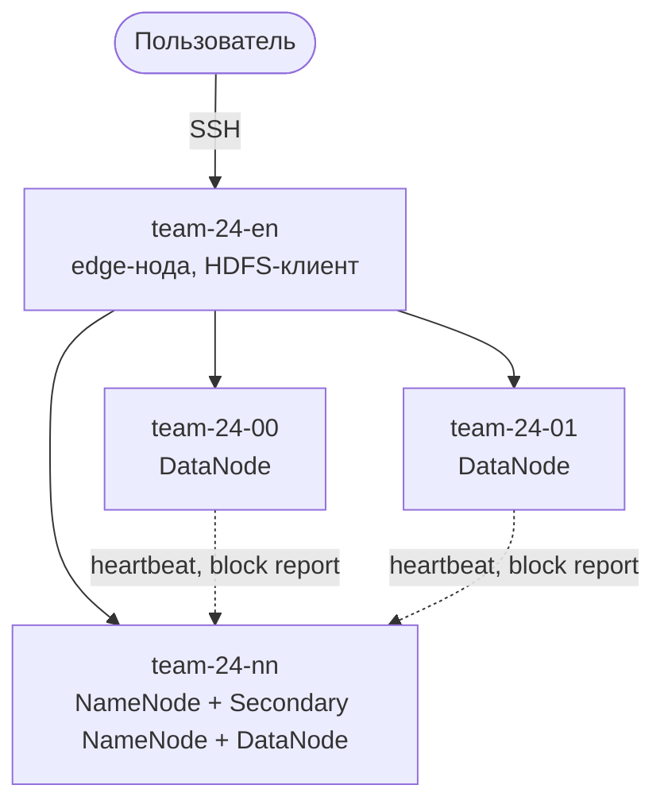

# Домашнее задание №1 — развёртывание HDFS-кластера

Цель данной работы — развернуть надежное распределённое хранилище на базе
Apache Hadoop HDFS 3.4.1 для команды `team-24`.

В рамках задания настроен кластер HDFS, который включает в себя:

- NameNode и Secondary NameNode;
- три DataNode с коэффициентом репликации 3;
- edge-нода с HDFS-клиентом, которая нужна для запуска задач, загрузки файлов в HDFS и администрирования кластера, чтобы лишний раз не нагружать служебные узлы NameNode и DataNode посторонними задачами.

Развёртывание полностью автоматизировано набором скриптов. Они устанавливают Java 11 и Hadoop, настраивают узлы и сетевые имена (понятные названия машин вместо IP-адресов, например, team-24-nn), создают службы systemd, запускают компоненты в правильном порядке и поддерживают безопасный повторный запуск.

Добавлена автоматическая проверка состояния кластера: доступность всех служб,
регистрация трёх DataNode, отсутствие мёртвых узлов, отсутствие повреждённых блоков, запись и чтение
тестового файла, наличие трёх реплик, проверка контрольной суммы и отсутствие критических ошибок в логах.


## Архитектура кластера

Кластер состоит из четырёх виртуальных машин:

| Хост          | IP          | Роль                                         |
|---------------|-------------|----------------------------------------------|
| `team-24-en`  | 10.24.0.10  | Edge-нода: точка входа, HDFS-клиент, запуск скриптов |
| `team-24-nn`  | 10.24.0.11  | NameNode, Secondary NameNode, DataNode       |
| `team-24-00`  | 10.24.0.12  | DataNode                                     |
| `team-24-01`  | 10.24.0.13  | DataNode                                     |

Итак, как можно заметить, архитектура нашего кластера состоит из Edge-ноды, NameNode, Secondary NameNode (которая выполняет периодическое слияние метаданных NameNode — checkpoint) и трех DataNode. Edge-нода позволяет нам безопасно взаимодействовать с самим кластером. Так как на курсе выделены 4 виртуальные машины, то оставшиеся три отведены на размещение компонентов NameNode, Secondary NameNode и трех DataNode. Чтобы получить три DataNode, пришлось поставить один из них на ту же машину, что и NameNode и Secondary NameNode. 

Коэффициент репликации в нашем случае равен 3, то есть при трех DataNode это максимально возможный коэффициент и при этом стандартное значение в HDFS. На практике это обеспечивает хорошую надежность сохранения данных, так как они остаются доступными, даже если выйдут из строя два DataNode из трёх.



Как можно видеть на схеме выше, узлы кластера недоступны из интернета напрямую — работа ведётся через edge-ноду.

## Структура репозитория

```
homework1/
├── README.md               # эта инструкция
├── config.env              # параметры развёртывания: хосты, IP-адреса, версии, пути
├── deploy.sh               # запуск всего развёртывания одной командой
├── remote/
│   └── node.sh             # скрипт, который выполняется на каждом узле кластера
├── scripts/
│   ├── lib.sh              # общие функции, подключается остальными скриптами
│   ├── 00-check.sh         # предварительные проверки
│   ├── 01-download.sh      # загрузка Java и Hadoop
│   ├── 02-install.sh       # установка на все узлы
│   ├── 03-configure.sh     # конфигурация Hadoop и узлов
│   ├── 04-start.sh         # форматирование NameNode и запуск служб
│   ├── 05-verify.sh        # проверка целостности кластера
│   ├── stop.sh             # остановка кластера
│   └── destroy.sh          # полное удаление кластера
└── templates/
    ├── core-site.xml       # шаблон: адрес NameNode
    ├── hdfs-site.xml       # шаблон: репликация, каталоги NameNode, Secondary NameNode и DataNode
    ├── hadoop-env.sh       # шаблон: переменные окружения Hadoop (JAVA_HOME и др.)
    └── hadoop-hdfs@.service # шаблон службы systemd для всех компонентов HDFS
```

## Как запустить

### Что нужно заранее

- Доступ к edge-ноде по SSH-ключу (публичный ключ должен быть добавлен на сервер).
- На edge-ноде — SSH-ключ для доступа к внутренним узлам кластера (путь задаётся в `config.env`, у нас это ключ `team_internal`).
- На всех узлах — права `sudo` без пароля.
- Установленный на edge-ноде `git`. Если его нет, установите:
```bash
  sudo apt-get install -y git
```

### 1. Подключиться к edge-ноде

Все дальнейшие команды выполняются на edge-ноде — единственной машине кластера с внешним IP-адресом:

```bash
ssh team@2.59.83.107
```

### 2. Скачать репозиторий и запустить развёртывание

```bash
git clone https://github.com/ReallyMix/PlatformsOfData.git
cd PlatformsOfData/homework1
./deploy.sh
```

Если репозиторий уже был скачан ранее, вместо `git clone` достаточно обновить его:

```bash
cd PlatformsOfData
git pull
cd homework1
./deploy.sh
```

Скрипт `deploy.sh` последовательно выполняет все шаги развёртывания — от предварительных проверок до проверки целостности кластера. Это занимает 5–15 минут, в зависимости от скорости загрузки дистрибутивов.

### 3. Проверить результат

При успешном развёртывании в конце вывода появится строка:

```
OK Кластер целостный: NameNode, Secondary NameNode и 3 DataNode работают, деградировавших узлов нет
```

Если вместо неё появилось `FAIL`, в выводе будет указано, на каком шаге и какая проверка не прошла. После устранения причины `deploy.sh` можно безопасно запустить повторно: уже скачанные архивы не загружаются заново, Java и Hadoop не переустанавливаются, а NameNode не форматируется повторно.

### 4. Открыть веб-интерфейс NameNode

Веб-интерфейс доступен только внутри сети кластера, поэтому порт нужно пробросить через edge-ноду. На своём компьютере, в новом окне терминала, выполните:

```bash
ssh -L 9870:team-24-nn:9870 team@2.59.83.107
```

Не закрывая это окно, нужно открыть в браузере [http://localhost:9870](http://localhost:9870). На главной странице должно быть **Live Nodes: 3** и **Dead Nodes: 0**, а на вкладке **Datanodes** — три узла в статусе **In Service**. Готовую команду для туннеля (сразу для NameNode и Secondary NameNode) печатает в конце работы скрипт `05-verify.sh`.

Чтобы закрыть туннель, выполните `exit` в этом окне терминала.

### Остановка и удаление кластера

На edge-ноде из папки `homework1`:

```bash
# остановить все службы HDFS, сохранив данные и конфигурацию
./scripts/stop.sh

# запустить кластер снова (повторного форматирования не будет)
./scripts/04-start.sh

# полностью удалить кластер с узлов, включая данные (скрипт попросит подтверждение)
./scripts/destroy.sh
```

## Описание скриптов

### `lib.sh` — общая библиотека

Данный файл не запускается отдельно. Он подключается остальными скриптами через команду `source`. После этого всё, что объявлено в `lib.sh`, становится доступно в скрипте, как будто было написано прямо в нём. Дело в том, что многие действия повторяются почти в каждом скрипте: подключение к узлу по SSH, выполнение на нём команды, вывод сообщений, остановка при ошибке. Чтобы не копировать один и тот же код в каждый файл, он вынесен в одно место. Если нужно что-то поменять — например, способ подключения к узлам, — правка делается один раз в `lib.sh`, и все скрипты сразу начинают работать по-новому.

Что именно содержит `lib.sh`:

- загрузку параметров из `config.env` и строгий режим Bash (скрипт останавливается при любой ошибке);
- функции вывода сообщений: `log`, `ok`, `warn` и `die` (вывести ошибку и остановиться);
- функции работы с узлами: выполнение команды на узле по SSH (`on`), копирование файлов (`copy_to`), сборку и отправку на узел скрипта `node.sh` (`build_node_script`, `push_node`) и запуск на узле нужного действия (`node_do`);
- генерацию конфигов из шаблонов (`render_configs`);
- вспомогательные функции: выполнение команд `hdfs` от имени пользователя `hadoop` (`hdfs_admin`), получение метрик NameNode через её JMX-интерфейс (`nn_metric`) и ожидание открытия порта службы (`wait_port`).

### `00-check.sh` — предварительные проверки

Данный скрипт убеждается, что окружение готово к развёртыванию, ещё до того, как что-то будет изменено на узлах. Поэтому, чтобы не наткнуться на какую-либо проблему на середине установки, когда часть узлов уже настроена, а часть нет, и кластер остался в полуготовом состоянии, лучше узнать о проблеме сразу. Скрипт проверяет:

- что он запущен на edge-ноде (иначе выводит предупреждение);
- что на edge-ноде есть SSH-ключ для доступа к узлам и все нужные утилиты (`ssh`, `scp`, `curl`, `tar`, `sha256sum`, `sha512sum` и др.);
- что каждый узел доступен по SSH и на нём работает `sudo` без пароля (для установки программ, создания пользователя `hadoop` и служб `systemd` нужны права администратора);
- что у всех узлов одинаковая архитектура процессора с edge-нодой, ведь архивы скачиваются один раз на edge-ноде и раздаются на все узлы;
- что на каждом узле достаточно свободного места на диске (меньше 4 ГБ — предупреждение);
- что с edge-ноды есть доступ в интернет для загрузки дистрибутивов.

Для наглядности скрипт выводит таблицу с характеристиками всех узлов: IP-адрес, архитектура, число ядер, объём памяти, свободное место и версия ОС. Если что-то критичное не так, скрипт сообщает об ошибке и останавливается.

### `01-download.sh` — загрузка дистрибутивов

Скачивает на edge-ноду архивы Java 11 и Hadoop 3.4.1 и проверяет их контрольные суммы, чтобы удостовериться в целостности этих архивов. Если архивы уже скачаны и не повреждены, повторная загрузка не выполняется. Если контрольная сумма не совпала, повреждённый архив удаляется и скрипт останавливается. Внутренним узлам интернет не нужен: архивы раздаются на них с edge-ноды.

### `02-install.sh` — установка

Устанавливает всё необходимое на каждый узел кластера, включая edge-ноду, где Hadoop нужен как HDFS-клиент. 

На предыдущем шаге (в скрипте `01-download.sh`) архивы Java и Hadoop скачиваются на edge-ноду. Но работать Hadoop должен на каждой машине кластера, поэтому `02-install.sh` копирует эти архивы на все узлы и запускает на них установку. Если на узле Java и Hadoop уже установлены, копирование архивов пропускается. После установки временные копии архивов с узлов удаляются. Далее на каждом узле при установке прописываются сетевые имена всех узлов кластера в `/etc/hosts`, чтобы узлы могли обращаться друг к другу по имени. После этого скрипт создает системного пользователя `hadoop`. Службы HDFS лучше запускать не от имени администратора (root) и не от личной учетной записи, например team, а от отдельного служебного пользователя. Это вопрос безопасности и порядка: если в Hadoop найдётся уязвимость, злоумышленник получит права только этого пользователя, а не всей системы. Плюс все файлы и процессы Hadoop принадлежат одному владельцу. Пользователь создаётся как системный, поэтому получает номер ниже 1000, то есть из диапазона служебных учётных записей, в нашем случае `uid=999`. Также скрипт создаёт основную группу `hadoop` с номером, который также ниже 1000 (в нашем случае `gid=988(hadoop)`). Группы нужны, чтобы раздавать права сразу нескольким пользователям. Затем Java и Hadoop распаковываются в каталог установки `/opt`, и на каждом узле появляются папки вроде `/opt/java` и `/opt/hadoop`. В конце скрипт создаёт каталоги для данных и логов: HDFS нужно место, где хранить метаданные NameNode, блоки файлов на DataNode и снимки Secondary NameNode. Владельцем этих папок назначается пользователь `hadoop`, иначе службы не смогут туда писать.

### `03-configure.sh` — конфигурация

Генерирует конфигурационные файлы Hadoop и раскладывает их на все узлы кластера:

- выводит, на каких хостах размещены NameNode, Secondary NameNode и DataNode (значения берутся из `config.env`), и проверяет, что DataNode не меньше, чем коэффициент репликации; иначе HDFS не сможет хранить нужное число копий блоков, и скрипт останавливается с ошибкой;
- генерирует на edge-ноде (в каталоге `build/conf`) конфигурационные файлы из шаблонов в папке `templates`, подставляя значения из `config.env`: `core-site.xml` (адрес NameNode), `hdfs-site.xml` (коэффициент репликации 3, каталоги NameNode, Secondary NameNode и DataNode), `hadoop-env.sh` (переменные окружения, в том числе путь к Java) и `hadoop-hdfs@.service` (шаблон службы `systemd` для всех компонентов HDFS), а также файл `workers` со списком DataNode. Если в каком-то файле осталось незаполненное значение, скрипт останавливается с ошибкой;
- копирует готовые конфиги и скрипт `remote/node.sh` на каждый узел кластера и запускает на нём действие `configure`, которое размещает конфиги в каталоге Hadoop и устанавливает службу `systemd`, чтобы компоненты автоматически запускались после перезагрузки виртуальной машины.

### `04-start.sh` — запуск кластера

Форматирует NameNode только при первом запуске. То есть, если NameNode уже отформатирован, то этот шаг пропускается, чтобы не потерять метаданные. Затем скрипт запускает службы в правильном порядке и после каждого шага убеждается, что служба действительно заработала:

1. NameNode — скрипт ждёт, пока она откроет порты для подключений и веб-интерфейса;
2. DataNode на всех узлах — скрипт ждёт, пока все три DataNode зарегистрируются в NameNode;
3. Secondary NameNode — скрипт ждёт, пока она откроет свой порт.

В конце скрипт дожидается, пока NameNode выйдет из безопасного режима, в котором HDFS доступна только для чтения. Если какой-то этап не завершился за отведённое время, скрипт останавливается с ошибкой и подсказывает, где искать логи.

### `05-verify.sh` — проверка кластера

Автоматически проверяет, что кластер целостный:

1. все службы запущены и работают;
2. на NameNode зарегистрированы три живые DataNode, мёртвых и выводимых из эксплуатации нет;
3. нет повреждённых и отсутствующих блоков;
4. безопасный режим выключен;
5. Secondary NameNode отвечает на запросы;
6. в HDFS записывается случайный файл размером 16 МБ с коэффициентом репликации 3, после чего проверяется, что файл исправен (`hdfs fsck`), у его блоков три живые реплики, а контрольная сумма MD5 прочитанного файла совпадает с исходной. Отдельно проверяется исправность всей файловой системы. Тестовый файл затем удаляется;
7. в логах служб нет записей уровня ERROR и FATAL.

Скрипт выполняет все проверки до конца и помечает каждую непройденную строкой `FAIL`. Если хотя бы одна проверка не прошла, в конце скрипт завершается с ошибкой. При успехе он выводит итоговое сообщение и готовую команду для открытия веб-интерфейсов NameNode и Secondary NameNode через SSH-туннель.

### `stop.sh` — остановка кластера

Корректно останавливает все службы HDFS в обратном порядке: Secondary NameNode → DataNode → NameNode. Данные и конфигурация сохраняются, кластер можно снова запустить через `04-start.sh`, повторного форматирования при этом не будет.

### `destroy.sh` — полное удаление

Полностью удаляет HDFS со всех узлов, включая данные. Это нужно, чтобы развернуть кластер заново с чистого листа. На каждом узле выполняется действие `purge` из `node.sh`, после чего удаляются временные файлы развёртывания. Скачанные архивы в `dist/` на edge-ноде сохраняются, поэтому повторное развёртывание не требует новой загрузки.

Поскольку операция необратима, скрипт просит подтверждение: нужно ввести идентификатор кластера. Чтобы запустить без вопроса, используйте `./scripts/destroy.sh --yes`.

### `config.env` — параметры

Все настройки развёртывания в одном месте: имена и IP-адреса узлов, распределение ролей (какой хост — NameNode, Secondary NameNode, DataNode), коэффициент репликации, порты служб, версии Java и Hadoop, зеркала для загрузки, пути установки, каталоги данных и логов, SSH-ключ и пользователь для доступа к узлам. Чтобы развернуть кластер на других машинах, достаточно поменять этот файл.

### `deploy.sh` — запуск развёртывания
Последовательно выполняет скрипты `00`–`05`, разворачивая кластер одной командой.

### `remote/node.sh` — действия на узле

Содержит все действия, которые выполняются непосредственно на узлах кластера: установка (`install`), размещение конфигурации (`configure`), форматирование NameNode (`format`), запуск и остановка служб (`start`, `stop`), проверка состояния (`status`), проверка логов (`logs`) и полное удаление (`purge`). Перед использованием к нему приписываются параметры из `config.env`, и итоговый файл копируется на узел. Скрипты с edge-ноды вызывают нужное действие на нужном узле от имени администратора.

После проделанной работы мы решили убедиться в том, что все функционирует корректно при помощи веб-интерфейса нашей NameNode:


