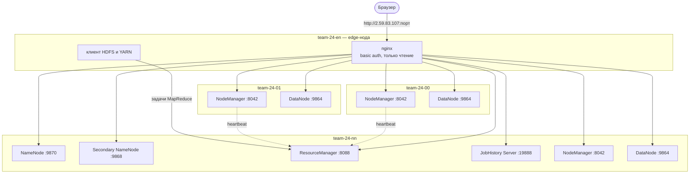

# Домашнее задание №2 — развёртывание YARN и публикация веб-интерфейсов

Цель работы — развернуть менеджер ресурсов YARN поверх HDFS-кластера из [домашнего задания №1](../homework1/README.md) и опубликовать веб-интерфейсы основных и вспомогательных демонов кластера для внешнего использования.

В рамках задания:

- развёрнуты **ResourceManager** (главный демон YARN, распределяет ресурсы кластера) и три **NodeManager** (запускают контейнеры с задачами на узлах);
- развёрнут вспомогательный демон **MapReduce JobHistory Server**, который хранит историю выполненных задач MapReduce и их логи;
- настроен запуск задач MapReduce в YARN;
- веб-интерфейсы всех демонов кластера (HDFS и YARN) опубликованы на внешнем IP-адресе edge-ноды через **nginx** с доступом по паролю и только на чтение.

Развёртывание автоматизировано набором Bash-скриптов, которые продолжают скрипты первого задания: используют тот же `config.env`, общие функции из `lib.sh`, тот же подход с шаблонами конфигов и службами `systemd`. Все шаги можно безопасно запускать повторно.

## Архитектура

| Хост          | IP          | Роли из ДЗ №1                               | Роли из ДЗ №2 |
|---------------|-------------|---------------------------------------------|---------------|
| `team-24-en`  | 10.24.0.10  | edge-нода, HDFS-клиент                      | клиент YARN, **nginx** (публикация веб-интерфейсов) |
| `team-24-nn`  | 10.24.0.11  | NameNode, Secondary NameNode, DataNode      | **ResourceManager**, **NodeManager**, **JobHistory Server** |
| `team-24-00`  | 10.24.0.12  | DataNode                                    | **NodeManager** |
| `team-24-01`  | 10.24.0.13  | DataNode                                    | **NodeManager** |

Почему так:

- **NodeManager стоит на каждом узле с DataNode.** Так YARN может запускать задачи на тех же машинах, где лежат блоки данных, и не гонять данные по сети (принцип «вычисления ближе к данным»).
- **ResourceManager и JobHistory Server — на `team-24-nn`.** Отдельных машин под них у нас нет: курс выделил четыре ВМ, а edge-нода служит точкой входа. Поэтому управляющие демоны собраны на одной машине с NameNode, как и Secondary NameNode в первом задании.
- **nginx — на edge-ноде.** Только у неё есть внешний IP, внутренние узлы из интернета недоступны. nginx работает как обратный прокси: принимает запрос на внешний адрес и пересылает его нужному демону во внутренней сети.



## Опубликованные веб-интерфейсы

Каждый интерфейс открывается на своём порту внешнего адреса edge-ноды. Для основных демонов внешний порт совпадает с их стандартным портом. Однотипные демоны на разных узлах (NodeManager, DataNode) слушают один и тот же порт, поэтому снаружи им выделены соседние порты.

| Демон | Тип | Адрес снаружи | Куда проксируется |
|---|---|---|---|
| NameNode | основной (HDFS) | http://2.59.83.107:9870 | `team-24-nn:9870` |
| ResourceManager | основной (YARN) | http://2.59.83.107:8088 | `team-24-nn:8088` |
| Secondary NameNode | вспомогательный | http://2.59.83.107:9868 | `team-24-nn:9868` |
| JobHistory Server | вспомогательный | http://2.59.83.107:19888 | `team-24-nn:19888` |
| NodeManager на `team-24-nn` | рабочий | http://2.59.83.107:8042 | `team-24-nn:8042` |
| NodeManager на `team-24-00` | рабочий | http://2.59.83.107:8043 | `team-24-00:8042` |
| NodeManager на `team-24-01` | рабочий | http://2.59.83.107:8044 | `team-24-01:8042` |
| DataNode на `team-24-nn` | рабочий | http://2.59.83.107:9864 | `team-24-nn:9864` |
| DataNode на `team-24-00` | рабочий | http://2.59.83.107:9865 | `team-24-00:9864` |
| DataNode на `team-24-01` | рабочий | http://2.59.83.107:9866 | `team-24-01:9864` |

Список задаётся переменной `WEB_UI` в `config.env`, по нему автоматически генерируется конфиг nginx.

Ограничение: страницы Hadoop содержат ссылки на внутренние имена узлов (например, ссылка на NodeManager в интерфейсе ResourceManager ведёт на `team-24-00:8042`). Снаружи такие ссылки не откроются — нужно перейти по соответствующему адресу из таблицы.

### Безопасность

Веб-интерфейс и REST API ResourceManager без защиты позволяют любому запустить на кластере произвольный код, и открытые в интернет кластеры Hadoop регулярно взламывают боты-майнеры. Поэтому публикация сделана с двумя ограничениями:

- **вход по логину и паролю** (HTTP basic auth). Логин задаётся в `config.env` (`team24`), пароль генерируется случайно при первом запуске и хранится на edge-ноде в `homework2/.secrets/web-password` (в git не попадает);
- **только чтение**: nginx пропускает лишь запросы GET и HEAD, а любые изменяющие запросы (POST, PUT, DELETE) отклоняет с кодом 403. Смотреть интерфейсы можно, отправить задачу через REST API — нет.

## Структура

```
homework2/
├── README.md                  # эта инструкция
├── config.env                 # параметры YARN и публикации (дополняет ../homework1/config.env)
├── deploy.sh                  # развёртывание одной командой
├── .gitignore                 # build/ и .secrets/ не попадают в git
├── remote/
│   └── node-yarn.sh           # действия, которые выполняются на каждом узле
├── scripts/
│   ├── lib.sh                 # общие функции (подключает lib.sh первого задания)
│   ├── 00-check.sh            # проверка готовности кластера
│   ├── 01-configure.sh        # генерация и раскладка конфигов YARN и MapReduce
│   ├── 02-start.sh            # запуск ResourceManager, NodeManager и JobHistory Server
│   ├── 03-publish.sh          # публикация веб-интерфейсов через nginx
│   ├── 04-verify.sh           # проверка YARN, тестовая задача и проверка веб-интерфейсов
│   ├── stop.sh                # остановка YARN
│   └── destroy.sh             # удаление YARN и публикации
└── templates/
    ├── yarn-site.xml          # шаблон: ResourceManager, NodeManager, ресурсы, логи
    ├── mapred-site.xml        # шаблон: MapReduce в YARN, память задач, JobHistory Server
    ├── hadoop-yarn@.service   # шаблон службы systemd для ResourceManager и NodeManager
    └── hadoop-mapred@.service # шаблон службы systemd для JobHistory Server
```

При запуске создаются служебные каталоги `build/` (сгенерированные конфиги) и `.secrets/` (пароль от веб-интерфейсов).

## Как запустить

### Что нужно заранее

- Развёрнутый и работающий HDFS-кластер из первого задания (`homework1/deploy.sh`). Второе задание использует его скрипты и `config.env`, поэтому папки `homework1` и `homework2` должны лежать рядом.
- Всё то же, что и для первого задания: доступ к edge-ноде, SSH-ключ `team_internal` на edge-ноде, `sudo` без пароля на всех узлах.
- Доступ из edge-ноды в интернет для установки nginx через `apt` (если nginx ещё не установлен).

### 1. Подключиться к edge-ноде и обновить репозиторий

```bash
ssh team@2.59.83.107
cd PlatformsOfData
git pull
cd homework2
```

### 2. Запустить развёртывание

```bash
./deploy.sh
```

Скрипт выполняет шаги `00`–`04` по порядку. Это занимает 2–5 минут, большую часть времени — тестовая задача MapReduce.

### 3. Проверить результат

При успешном развёртывании в конце вывода появится строка:

```
OK YARN работает: ResourceManager, 3 NodeManager и JobHistory Server, тестовая задача выполнена, веб-интерфейсы опубликованы
```

и список адресов веб-интерфейсов. Пароль для входа можно посмотреть на edge-ноде:

```bash
cat ~/PlatformsOfData/homework2/.secrets/web-password
```

Если вместо итоговой строки появилось `FAIL`, в выводе будет указано, какая проверка не прошла. После устранения причины `deploy.sh` можно запустить повторно.

### 4. Открыть веб-интерфейсы

Откройте в браузере на своём компьютере, например, http://2.59.83.107:8088 (ResourceManager), введите логин `team24` и пароль. На странице **Nodes** должны быть три узла в состоянии **RUNNING**, а на главной странице — тестовая задача `QuasiMonteCarlo` со статусом **SUCCEEDED**. Та же задача видна в JobHistory Server: http://2.59.83.107:19888.

Если страницы не открываются, хотя `deploy.sh` завершился успешно, значит, входящие подключения на эти порты блокирует файрвол облачной платформы. В этом случае интерфейсы можно открыть через SSH-туннель до nginx на edge-ноде:

```bash
ssh -N -L 8088:localhost:8088 -L 19888:localhost:19888 -L 9870:localhost:9870 team@2.59.83.107
```

и затем http://localhost:8088 и т. д.

### 5. Запустить свою задачу (по желанию)

С edge-ноды от имени пользователя `hadoop`:

```bash
# вычисление числа Pi методом Монте-Карло
sudo -u hadoop /opt/hadoop/bin/yarn jar \
    /opt/hadoop/share/hadoop/mapreduce/hadoop-mapreduce-examples-3.4.1.jar pi 3 1000

# список узлов YARN
sudo -u hadoop /opt/hadoop/bin/yarn node -list
```

### Остановка и удаление

На edge-ноде из папки `homework2`:

```bash
# остановить YARN (HDFS и nginx продолжат работать)
./scripts/stop.sh

# запустить YARN снова
./scripts/02-start.sh

# удалить YARN и публикацию веб-интерфейсов (HDFS не затрагивается)
./scripts/destroy.sh
```

## Описание файлов

### `config.env` — параметры

Параметры, относящиеся только к YARN: на каких узлах работают ResourceManager, NodeManager и JobHistory Server, их порты, сколько памяти и ядер каждый NodeManager отдаёт под контейнеры, сколько памяти получают контейнеры задач MapReduce, а также логин и список публикуемых веб-интерфейсов. Всё остальное (узлы, пути, пользователь `hadoop`, версии) берётся из `config.env` первого задания, чтобы не дублировать настройки.

Памяти под контейнеры выделено 2 ГБ на узел. Это значение должно быть заметно меньше объёма RAM узла, ведь на `team-24-nn` ещё работают NameNode, Secondary NameNode, DataNode, ResourceManager и JobHistory Server. Скрипт `00-check.sh` предупредит, если памяти может не хватить.

### `remote/node-yarn.sh` — действия на узле

Аналог `node.sh` из первого задания, но для YARN. Содержит действия, которые выполняются на узлах от имени администратора: размещение конфигурации (`configure`), запуск и остановка демонов (`start`, `stop`), проверка состояния (`status`), проверка логов (`logs`) и удаление (`purge`). Роль узла определяется по `config.env`: на `team-24-nn` — ResourceManager, NodeManager и JobHistory Server, на `team-24-00` и `team-24-01` — NodeManager, edge-нода — клиент.

### `lib.sh` — общая библиотека

Подключает `lib.sh` первого задания, поэтому все его функции (выполнение команд на узлах по SSH, копирование файлов, вывод сообщений, метрики NameNode, ожидание порта) доступны и здесь. Дополнительно содержит:

- загрузку `config.env` второго задания;
- сборку и отправку на узлы скрипта `node-yarn.sh` и запуск на узле нужного действия (`build_yarn_node_script`, `push_yarn`, `yarn_do`);
- генерацию конфигов YARN из шаблонов (`render_yarn_configs`) и конфига nginx по списку `WEB_UI` (`render_nginx_conf`);
- генерацию и хранение пароля к веб-интерфейсам (`web_password`);
- выполнение команд `yarn` от имени пользователя `hadoop` (`yarn_cmd`) и получение метрик ResourceManager через JMX (`rm_metric`).

### `00-check.sh` — проверка готовности

Проверяет, что HDFS из первого задания работает (все три DataNode живы), Hadoop установлен на всех узлах, на edge-ноде есть `sudo` без пароля и нужные утилиты. Выводит таблицу с ролями YARN и объёмом памяти каждого узла и предупреждает, если NodeManager отдаёт под контейнеры больше 60% памяти узла. Также проверяет, что контейнеры задач MapReduce помещаются в память NodeManager.

### `01-configure.sh` — конфигурация

Генерирует на edge-ноде из шаблонов в папке `templates` файлы `yarn-site.xml`, `mapred-site.xml` и шаблоны служб `systemd`, подставляя значения из обоих `config.env`. Затем копирует их на все узлы, включая edge-ноду (с неё отправляются задачи, поэтому клиенту тоже нужны конфиги), и запускает на каждом узле действие `configure`. Оно раскладывает конфиги в каталог Hadoop, устанавливает службы `systemd`, создаёт рабочие каталоги контейнеров и включает автозапуск только тех демонов, которые назначены этому узлу.

Главное в конфигах:

- `yarn-site.xml` — адрес ResourceManager; сервис `mapreduce_shuffle` на NodeManager, через который reduce-задачи забирают результаты map-задач; ресурсы узла под контейнеры; сбор логов контейнеров в HDFS после завершения задачи (их потом показывает JobHistory Server);
- `mapred-site.xml` — запуск MapReduce в YARN (`mapreduce.framework.name=yarn`); переменная `HADOOP_MAPRED_HOME` для контейнеров (без неё задачи падают с ошибкой «Could not find or load main class MRAppMaster»); память контейнеров; адрес JobHistory Server.

### `02-start.sh` — запуск

Создаёт в HDFS каталоги, нужные задачам MapReduce (`/tmp` с правами на запись для всех и `/user/hadoop`), и запускает демоны по порядку, после каждого шага убеждаясь, что он действительно заработал:

1. **ResourceManager** — скрипт ждёт, пока он откроет порты для клиентов и веб-интерфейса;
2. **NodeManager** на трёх узлах — скрипт ждёт, пока все три зарегистрируются в ResourceManager (проверяется через его метрики);
3. **JobHistory Server** — скрипт ждёт, пока он откроет порт веб-интерфейса.

### `03-publish.sh` — публикация веб-интерфейсов

Устанавливает nginx на edge-ноду (если его нет), генерирует конфиг с отдельным `server` на каждый веб-интерфейс из `WEB_UI`, создаёт файл с логином и паролем, проверяет конфиг командой `nginx -t` и перезапускает nginx. Если на edge-ноде включён файрвол `ufw`, открывает в нём нужные порты. В конце выводит список опубликованных адресов.

### `04-verify.sh` — проверка

Проверяет в пять этапов:

1. **демоны на узлах** — запущены все назначенные службы, процессы видны в `jps`;
2. **состояние по данным ResourceManager** (JMX): три активных NodeManager, ноль потерянных, нездоровых и выведенных из эксплуатации; выводится `yarn node -list`;
3. **тестовая задача MapReduce** — вычисление числа Pi из стандартных примеров Hadoop. Проверяется, что задача завершилась в YARN со статусом `SUCCEEDED` и появилась в JobHistory Server;
4. **веб-интерфейсы через nginx** — каждый из десяти адресов отвечает кодом 200; без пароля nginx отвечает 401, а на изменяющий запрос к REST API ResourceManager — 403;
5. **логи демонов YARN** — нет записей уровня FATAL (записи ERROR выводятся как предупреждение).

Скрипт выполняет все проверки до конца, помечает непройденные строкой `FAIL` и в этом случае завершается с ошибкой.

### `stop.sh` — остановка

Останавливает демоны в обратном порядке: JobHistory Server → NodeManager → ResourceManager. HDFS и nginx продолжают работать, запустить YARN снова можно через `02-start.sh`.

### `destroy.sh` — удаление

Удаляет всё, что добавило второе задание: службы и конфиги YARN, рабочие каталоги и логи YARN на всех узлах, конфиг nginx и файл с паролем на edge-ноде. HDFS из первого задания не затрагивается, nginx остаётся установленным. Скрипт просит подтверждение (ввести идентификатор кластера) или запускается с флагом `--yes`.

## Проверка работы

После развёртывания мы убедились, что всё работает, через опубликованные веб-интерфейсы:

<!-- сюда вставить скриншоты: ResourceManager (Nodes — 3 узла RUNNING),
     список приложений с задачей QuasiMonteCarlo SUCCEEDED, JobHistory Server -->
