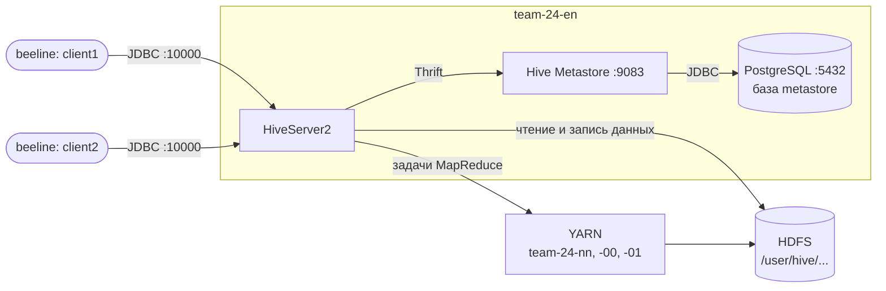

# Домашнее задание №3 — развёртывание Apache Hive и загрузка данных в партиционированную таблицу

Цель работы — развернуть Apache Hive 4.0.0-alpha-2 поверх кластера из [ДЗ №1](../homework1/README.md) (HDFS) и [ДЗ №2](../homework2/README.md) (YARN) так, чтобы с ним могли одновременно работать несколько клиентов, и автоматизировать загрузку данных в партиционированную таблицу.

В рамках задания:

- метаданные Hive хранятся во внешней базе **PostgreSQL**, а не во встроенной Derby;
- **Hive Metastore** запущен отдельной службой и раздаёт метаданные по сети;
- **HiveServer2** принимает подключения клиентов по JDBC — одновременно от нескольких пользователей;
- данные из CSV-файла автоматически загружаются в HDFS и раскладываются по партициям таблицы `shop.orders` в формате Parquet;
- скрипт проверки запускает два клиента одновременно и показывает, что оба получают результат.

Всё развёртывание выполняется одной командой `./deploy.sh`, каждый шаг можно безопасно запускать повторно.

## Почему не embedded-режим

У Hive есть два ключевых компонента: **Metastore** (хранит описания баз, таблиц, колонок, партиций и их расположение в HDFS) и **движок запросов**.

В embedded-режиме, который получается «по умолчанию», Metastore работает прямо внутри процесса клиента, а метаданные лежат во встроенной базе **Derby** в локальной папке. Derby в таком режиме допускает только одно подключение: пока один пользователь открыл `hive`, второй запустить его уже не сможет. Для учебного «попробовать» этого хватает, но для общего использования — нет.

Поэтому каждый компонент вынесен в отдельный сервис:

| Компонент | Embedded-режим | Наша установка |
|---|---|---|
| База метаданных | Derby, файлы в локальной папке, одно подключение | **PostgreSQL**, много подключений |
| Metastore | внутри процесса клиента | **отдельная служба**, порт 9083 |
| Подключение клиентов | только локальный CLI | **HiveServer2**, JDBC, порт 10000 |

Теперь любое число клиентов (`beeline`, DBeaver, программы на Python/Java) подключается к HiveServer2 по сети, HiveServer2 получает метаданные от Metastore, а тот хранит их в PostgreSQL.

## Архитектура

| Хост | Роли из ДЗ №1 и №2 | Роли из ДЗ №3 |
|---|---|---|
| `team-24-en` (edge) | HDFS-клиент, клиент YARN, nginx | **PostgreSQL**, **Hive Metastore**, **HiveServer2**, клиенты `beeline` |
| `team-24-nn` | NameNode, Secondary NameNode, DataNode, ResourceManager, NodeManager, JobHistory Server | — |
| `team-24-00` | DataNode, NodeManager | — |
| `team-24-01` | DataNode, NodeManager | — |

Hive размещён на edge-ноде, потому что:

- это клиентская точка входа в кластер — именно сюда подключаются пользователи;
- на `team-24-nn` уже работают шесть демонов HDFS и YARN, а памяти у каждой ВМ около 4 ГБ;
- только у edge-ноды есть доступ в интернет, нужный для установки PostgreSQL через `apt`.

Сам Hive данные не хранит и не обрабатывает: таблицы лежат в HDFS, а запросы, которым нужны вычисления (`INSERT ... SELECT`, `GROUP BY`), HiveServer2 превращает в задачи MapReduce и запускает в YARN из ДЗ №2.



Порты:

| Сервис | Порт | Кто подключается |
|---|---|---|
| PostgreSQL | 5432 | только Metastore (слушает `localhost`) |
| Hive Metastore | 9083 | HiveServer2 и другие сервисы Hive |
| HiveServer2 | 10000 | клиенты по JDBC (`beeline`, DBeaver и т. д.) |
| Веб-интерфейс HiveServer2 | 10002 | браузер, через SSH-туннель |

## Структура

```
homework3/
├── README.md               # эта инструкция
├── config.env              # параметры: версия Hive, пути, хост, база метаданных
├── deploy.sh               # развёртывание и загрузка данных одной командой
├── conf/
│   └── hive-site.xml       # шаблон конфигурации Hive
├── data/
│   └── orders.csv          # исходные данные — заказы интернет-магазина
├── sql/
│   └── load.sql            # создание таблиц и загрузка в партиционированную таблицу
└── scripts/
    ├── 01_postgres.sh      # установка PostgreSQL, пользователь и база для Metastore
    ├── 02_hive.sh          # установка Hive, конфиг, схема Metastore, службы systemd
    ├── 03_start.sh         # запуск Metastore и HiveServer2
    ├── 04_load.sh          # загрузка CSV в HDFS и в партиционированную таблицу
    └── 05_check.sh         # проверка: два клиента одновременно, партиции, метаданные
```

При запуске создаётся каталог `dist/` со скачанным архивом Hive (в git не попадает).

## Как запустить

### Что нужно заранее

- Работающий HDFS из ДЗ №1 и YARN из ДЗ №2. YARN обязателен: загрузка в партиционированную таблицу выполняется задачей MapReduce.
- Доступ к edge-ноде `team-24-en` по SSH и `sudo` без пароля.
- Доступ в интернет с edge-ноды: для `apt` и для скачивания Hive с `archive.apache.org`.

### 1. Подключиться к edge-ноде и обновить репозиторий

```bash
ssh team@2.59.83.107
cd PlatformsOfData
git pull
cd homework3
```

### 2. Запустить развёртывание

```bash
./deploy.sh
```

Скрипт по порядку выполняет пять шагов из папки `scripts/`. Первый запуск занимает 5–10 минут: больше всего времени уходит на скачивание Hive (несколько сотен мегабайт) и первый старт HiveServer2.

### 3. Проверить результат

В конце вывода шаг `05_check.sh` покажет:

- что службы `postgresql`, `hive@metastore` и `hive@hiveserver2` в состоянии `active`;
- ответы двух клиентов, которые подключились к HiveServer2 одновременно: `client1` получает количество заказов и выручку по дням, `client2` — список партиций;
- каталоги партиций в HDFS: `order_date=2026-10-01`, …, `order_date=2026-10-04`;
- записи о таблицах и партициях в базе `metastore` PostgreSQL.

Если какой-то шаг завершился с ошибкой, после исправления причины `./deploy.sh` можно запустить снова.

## Загрузка данных в партиционированную таблицу

### Исходные данные

Файл `data/orders.csv` — 35 заказов интернет-магазина за четыре дня:

```
order_id,order_date,customer,product,price,quantity
1,2026-10-01,kuznetsova,keyboard,3990.00,1
2,2026-10-01,sidorov,monitor,18990.00,3
...
```

### Как устроена загрузка

Скрипт `04_load.sh` выполняет два действия:

1. **Кладёт CSV в HDFS**, в каталог `/user/hive/raw/orders`.
2. **Выполняет `sql/load.sql` через `beeline`**, то есть как обычный клиент HiveServer2.

В `load.sql` загрузка идёт в два этапа — это стандартный приём для Hive:

1. **Таблица-источник `shop.orders_raw`** — внешняя (`EXTERNAL`) таблица поверх CSV-файла. Hive не копирует данные, а просто «накладывает» схему на файл в `/user/hive/raw/orders`. Для пропуска строки-заголовка задано свойство `skip.header.line.count`, но в этой версии Hive оно сработало не во всех случаях — подробнее ниже.

2. **Целевая таблица `shop.orders`** — партиционированная по дате заказа (`PARTITIONED BY (order_date STRING)`) и хранящая данные в колоночном формате **Parquet**. Данные переносятся запросом с **динамическим партиционированием**:

   ```sql
   SET hive.exec.dynamic.partition.mode=nonstrict;

   INSERT OVERWRITE TABLE orders PARTITION (order_date)
   SELECT order_id, customer, product, price, quantity, order_date
   FROM orders_raw
   WHERE order_id IS NOT NULL;
   ```
   
   Условие `WHERE order_id IS NOT NULL` страхует от попадания в таблицу строки-заголовка CSV. В Hive 4.0.0-alpha-2 при выполнении запроса через MapReduce свойство `skip.header.line.count` не сработало, и заголовок загрузился как обычная строка с отдельной партицией `order_date=order_date`. Текст `order_id` не превращается в число, поэтому у заголовка `order_id` равен `NULL`, и фильтр его отсекает.

   Значение партиции не указывается вручную: Hive берёт его из последней колонки `SELECT` и сам раскладывает строки по партициям. Сколько разных дат в данных — столько партиций и появится. Запрос выполняется задачей MapReduce в YARN.

В HDFS каждая партиция — это отдельный каталог:

```
/user/hive/warehouse/shop.db/orders/order_date=2026-10-01/
/user/hive/warehouse/shop.db/orders/order_date=2026-10-02/
/user/hive/warehouse/shop.db/orders/order_date=2026-10-03/
/user/hive/warehouse/shop.db/orders/order_date=2026-10-04/
```

Зачем это нужно: запрос с условием `WHERE order_date = '2026-10-02'` читает только один каталог, а не всю таблицу (partition pruning). На больших таблицах с данными за годы это ускоряет запросы в сотни раз.

Повторный запуск загрузки безопасен: таблицы создаются через `IF NOT EXISTS`, CSV перезаписывается (`-put -f`), а `INSERT OVERWRITE` заменяет содержимое партиций, а не дописывает дубликаты. Чтобы загрузить новые данные, достаточно заменить `data/orders.csv` и запустить `scripts/04_load.sh`.

## Как подключиться к Hive

### С edge-ноды

```bash
/opt/hive/bin/beeline -u jdbc:hive2://team-24-en:10000/ -n hadoop
```

Пример запросов:

```sql
SHOW DATABASES;
USE shop;
SHOW PARTITIONS orders;
SELECT * FROM orders WHERE order_date = '2026-10-02';
```

Можно открыть несколько терминалов и подключиться из каждого — все сессии будут работать одновременно.

### Со своего компьютера

HiveServer2 доступен только внутри сети кластера, поэтому, как и в ДЗ №2, используется SSH-туннель:

```bash
ssh -N -L 10000:team-24-en:10000 -L 10002:team-24-en:10002 team@2.59.83.107
```

После этого к Hive можно подключиться любым JDBC-клиентом (например, DBeaver) по адресу `jdbc:hive2://localhost:10000/`, а веб-интерфейс HiveServer2 открыть по адресу http://localhost:10002. На его главной странице видны активные сессии — удобно, чтобы убедиться, что подключено несколько клиентов.

## Описание файлов

### `config.env`

Все параметры в одном месте: версия Hive и ссылка на архив, пути установки Hive, Hadoop и Java, хост, на котором работает Hive, имя базы, пользователь и пароль для Metastore в PostgreSQL, адрес JDBC для клиентов. Файл подключается всеми скриптами.

### `conf/hive-site.xml`

Шаблон конфигурации Hive, значения подставляются из `config.env`:

- `javax.jdo.option.Connection*` — подключение Metastore к PostgreSQL (вместо встроенной Derby);
- `hive.metastore.uris` — адрес службы Metastore. Именно он делает Metastore удалённым: HiveServer2 обращается к нему по сети, а не поднимает свою копию;
- `hive.metastore.warehouse.dir` — каталог таблиц в HDFS;
- `hive.server2.thrift.*` — адрес и порт HiveServer2;
- `hive.server2.enable.doAs=false` — запросы выполняются от имени пользователя службы `hadoop`, а не подключившегося клиента. Иначе пришлось бы настраивать в Hadoop права на подмену пользователей (proxy users);
- `hive.execution.engine=mr` — запросы выполняются как задачи MapReduce в YARN;
- `hive.metastore.event.db.notification.api.auth=false` — разрешает HiveServer2 обращаться к API уведомлений Metastore, иначе в логах появляются ошибки авторизации.

### `scripts/01_postgres.sh`

Устанавливает PostgreSQL и JDBC-драйвер для него (`libpostgresql-jdbc-java`), создаёт пользователя `hive` и базу `metastore`. Если пользователь или база уже есть, создание пропускается.

### `scripts/02_hive.sh`

- скачивает архив Hive 4.0.0-alpha-2 (если его ещё нет) и распаковывает в `/opt`, делает ссылку `/opt/hive`;
- заменяет библиотеку Guava в Hive на версию из Hadoop. В Hive и Hadoop идут разные версии Guava, и без замены Hive падает при запуске с ошибкой `NoSuchMethodError`;
- подключает JDBC-драйвер PostgreSQL;
- генерирует `hive-site.xml` из шаблона;
- создаёт в HDFS каталог таблиц `/user/hive/warehouse` и временный каталог `/tmp/hive`;
- создаёт схему Metastore в PostgreSQL командой `schematool -initSchema` (только если её ещё нет);
- создаёт шаблонную службу systemd `hive@.service`, из которой запускаются `hive@metastore` и `hive@hiveserver2`. Службы работают от пользователя `hadoop`, как и демоны HDFS и YARN, и автоматически поднимаются после перезагрузки.

### `scripts/03_start.sh`

Запускает (или перезапускает, чтобы подхватить новый конфиг) сначала Metastore, затем HiveServer2, и после каждого ждёт, пока служба откроет свой порт. HiveServer2 зависит от Metastore, поэтому порядок важен. Если служба не поднялась, выводит последние строки её журнала.

### `scripts/04_load.sh` и `sql/load.sql`

Автоматическая загрузка данных в партиционированную таблицу — подробно описана в разделе выше.

### `scripts/05_check.sh`

Проверяет результат:

1. службы PostgreSQL, Metastore и HiveServer2 запущены;
2. **два клиента одновременно** (`client1` и `client2`) подключаются к HiveServer2 через `beeline` и выполняют разные запросы — это и есть проверка того, что Hive не в embedded-режиме;
3. в HDFS появились каталоги партиций;
4. в базе `metastore` PostgreSQL есть записи о таблицах (`TBLS`) и партициях (`PARTITIONS`) — то есть метаданные действительно хранятся во внешней базе.

В выводе таблица `orders` может иметь тип `EXTERNAL_TABLE`, хотя создавалась как обычная. Это особенность Hive 4: обычные (не транзакционные) управляемые таблицы он автоматически хранит как внешние с признаком `external.table.purge=true`, то есть при удалении таблицы её данные всё равно удаляются.

## Управление

На edge-ноде:

```bash
# состояние
systemctl status hive@metastore hive@hiveserver2

# остановить / запустить
sudo systemctl stop hive@hiveserver2 hive@metastore
bash scripts/03_start.sh

# логи служб
sudo journalctl -u hive@hiveserver2 -n 50
tail -n 50 /tmp/hadoop/hive.log
```

Полное удаление Hive (HDFS и YARN не затрагиваются):

```bash
sudo systemctl disable --now hive@hiveserver2 hive@metastore
sudo rm -f /etc/systemd/system/hive@.service && sudo systemctl daemon-reload
sudo rm -rf /opt/hive /opt/apache-hive-4.0.0-alpha-2-bin
sudo -u postgres psql -c "drop database metastore" -c "drop user hive"
sudo -u hadoop /opt/hadoop/bin/hdfs dfs -rm -r -skipTrash /user/hive
```

## Проверка работы


Вывод скрипта `05_check.sh` после развёртывания: службы PostgreSQL, Metastore и HiveServer2 запущены; два клиента одновременно подключились к HiveServer2 и получили ответы — `client1` посчитал заказы и выручку по дням, `client2` вывел список партиций; в HDFS созданы четыре каталога партиций, а метаданные таблиц и партиций хранятся в PostgreSQL.
