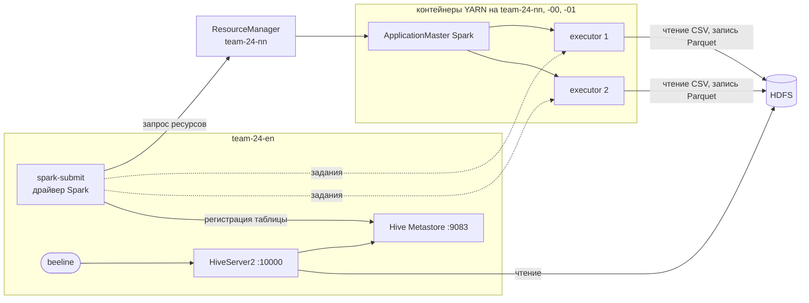

# Домашнее задание №4 — обработка данных в Apache Spark под управлением YARN

Цель работы — использовать Apache Spark под управлением YARN из [ДЗ №2](../homework2/README.md) для чтения данных из HDFS ([ДЗ №1](../homework1/README.md)), их трансформации и сохранения в виде партиционированной таблицы, которую затем можно прочитать стандартным клиентом Hive из [ДЗ №3](../homework3/README.md).

Задача Spark берёт «сырой» журнал продаж интернет-магазина (CSV в HDFS), очищает его, приводит типы, считает дневную статистику по городам и категориям товаров и сохраняет результат в таблицу `shop.sales_daily`, партиционированную по дате. После этого та же таблица читается через `beeline`.

Всё выполняется одной командой `./deploy.sh`, каждый шаг можно безопасно запускать повторно.

## Как решение покрывает требования задания

| № | Требование | Где и как выполнено |
|---|---|---|
| 1 | Запуск сессии Spark под управлением YARN | `job.py`: `SparkSession.builder.master("yarn")`, настройки в `conf/spark-defaults.conf`. Скрипт печатает `master: yarn` и идентификатор приложения YARN; приложение видно в веб-интерфейсе ResourceManager |
| 2 | Подключение к кластеру HDFS | Spark получает конфигурацию кластера через `HADOOP_CONF_DIR` и обращается к NameNode по адресу `hdfs://team-24-nn:9000`; библиотеки Spark тоже хранятся в HDFS |
| 3 | Чтение данных, предварительно загруженных в HDFS | `scripts/02_upload.sh` кладёт `data/sales.csv` в `/user/spark/input`, `job.py` читает его через `spark.read.csv` |
| 4 | Несколько трансформаций | Преобразование типов (`to_timestamp`, `cast`), очистка некорректных строк, нормализация названий городов, вычисляемые колонки (`sale_date`, `revenue`), агрегация `groupBy` с `count`, `sum`, `avg` |
| 5 | Партиционирование при сохранении | `partitionBy("sale_date")` — каждый день записывается в отдельный каталог `sale_date=...` |
| 6 | Сохранение как таблицы | `saveAsTable("shop.sales_daily")` — таблица регистрируется в Hive Metastore из ДЗ №3 |
| 7 | Чтение стандартным клиентом Hive | `scripts/04_check_hive.sh` читает таблицу через `beeline` и HiveServer2 |

## Архитектура

| Хост | Роли из ДЗ №1–3 | Роли в ДЗ №4 |
|---|---|---|
| `team-24-en` (edge) | клиент HDFS и YARN, nginx, PostgreSQL, Hive Metastore, HiveServer2 | **Spark (клиент)**: здесь запускается `spark-submit` и работает драйвер задачи |
| `team-24-nn` | NameNode, Secondary NameNode, DataNode, ResourceManager, NodeManager, JobHistory Server | контейнеры YARN с **исполнителями Spark** |
| `team-24-00` | DataNode, NodeManager | контейнеры YARN с **исполнителями Spark** |
| `team-24-01` | DataNode, NodeManager | контейнеры YARN с **исполнителями Spark** |

Spark не требует отдельных постоянно работающих демонов: он устанавливается только на edge-ноду как клиент, а вычисления выполняются в контейнерах YARN на узлах кластера. Задача запускается в режиме `client`:

1. `spark-submit` на edge-ноде запускает **драйвер** — процесс, который строит план вычислений и раздаёт задания;
2. драйвер просит у **ResourceManager** ресурсы, тот запускает в одном из контейнеров **ApplicationMaster** Spark;
3. ApplicationMaster получает ещё два контейнера на NodeManager'ах и запускает в них **исполнителей** (executors), которые читают блоки данных из HDFS и выполняют вычисления;
4. драйвер регистрирует результат в **Hive Metastore**, поэтому таблицу сразу видят и Spark, и Hive.



### Версия Spark

Используется **Spark 3.5.3** в сборке `bin-hadoop3`:

- на кластере стоит Java 11, а Spark 4.x требует Java 17; ветка 3.5 работает на Java 8, 11 и 17;
- сборка `hadoop3` содержит клиентские библиотеки Hadoop 3 и совместима с нашим кластером Hadoop 3.4.1;
- Spark общается с Hive Metastore по сети (Thrift), поэтому ему не нужен доступ к PostgreSQL и сам Hive.

## Структура

```
homework4/
├── README.md                  # эта инструкция
├── config.env                 # параметры: версия Spark, пути, адреса HDFS, Metastore, HiveServer2
├── deploy.sh                  # всё задание одной командой
├── job.py                     # задача Spark: чтение, трансформации, запись в таблицу
├── conf/
│   ├── spark-defaults.conf    # шаблон: запуск в YARN, ресурсы, библиотеки в HDFS, Hive Metastore
│   ├── spark-env.sh           # шаблон: пути к Java и конфигурации Hadoop
│   └── hive-site.xml          # шаблон: адрес Hive Metastore для Spark
├── data/
│   └── sales.csv              # исходные данные — журнал продаж за неделю
├── sql/
│   └── check.sql              # запросы для проверки таблицы через beeline
└── scripts/
    ├── 01_spark.sh            # установка и настройка Spark, загрузка его библиотек в HDFS
    ├── 02_upload.sh           # загрузка исходных данных в HDFS
    ├── 03_run.sh              # запуск задачи Spark в YARN
    └── 04_check_hive.sh       # проверка: партиции в HDFS и чтение таблицы клиентом Hive
```

При запуске создаётся каталог `dist/` со скачанным архивом Spark (в git не попадает).

## Как запустить

### Что нужно заранее

- Работающие HDFS (ДЗ №1), YARN (ДЗ №2), Hive Metastore и HiveServer2 (ДЗ №3).
- Доступ к edge-ноде `team-24-en` по SSH и `sudo` без пароля.
- Доступ в интернет с edge-ноды для скачивания Spark с `archive.apache.org`.

### 1. Подключиться к edge-ноде и обновить репозиторий

```bash
ssh team@2.59.83.107
cd PlatformsOfData
git pull
cd homework4
```

### 2. Запустить

```bash
./deploy.sh
```

Скрипт по порядку выполняет четыре шага из папки `scripts/`. Первый запуск занимает 5–15 минут: больше всего времени уходит на скачивание Spark (около 400 МБ) и загрузку его библиотек в HDFS. Повторные запуски проходят за пару минут.

### 3. Проверить результат

В выводе шага `03_run.sh`:

- `master: yarn` и идентификатор приложения вида `application_..._0009` — сессия Spark работает под управлением YARN;
- число прочитанных строк (441) и строк после очистки (431), схема данных до и после приведения типов;
- список партиций `sale_date=2026-10-01` … `sale_date=2026-10-07` и первые строки итоговой таблицы.

В выводе шага `04_check_hive.sh`:

- каталоги партиций в HDFS;
- результат запросов к `shop.sales_daily` через `beeline`: список таблиц, структура таблицы, партиции, суммарные заказы и выручка по дням, топ строк за один день.

Если какой-то шаг завершился с ошибкой, после исправления причины `./deploy.sh` можно запустить снова.

### 4. Посмотреть задачу в YARN

Через SSH-туннель из ДЗ №2 откройте веб-интерфейс ResourceManager http://localhost:8088 → **Applications**. Там будет приложение `hw4-sales-daily` с типом **SPARK** и статусом **SUCCEEDED**.

## Данные и трансформации

### Исходные данные

`data/sales.csv` — журнал продаж за неделю (441 строка): время покупки, город, категория, товар, цена и количество.

```
event_time,city,category,product,price,quantity
2026-10-01 10:00:54,SAINT PETERSBURG,books,comics,462.80,1
2026-10-01 12:07:57,Saint Petersburg,electronics,monitor,17491.63,2
...
```

Данные специально «грязные», как в реальной жизни: названия городов записаны в разном регистре и иногда с лишними пробелами, а в нескольких строках вместо цены пусто или `n/a`, вместо количества — слово. При чтении CSV все колонки имеют тип `string`.

### Что делает `job.py`

1. **Создаёт сессию Spark под управлением YARN** с поддержкой Hive (`enableHiveSupport`) и печатает адрес мастера и идентификатор приложения YARN.

2. **Читает CSV из HDFS** по полному адресу `hdfs://team-24-nn:9000/user/spark/input/sales.csv`.

3. **Приводит типы:**
   - `event_time`: строка → `timestamp` (`to_timestamp`);
   - `price`: строка → `double`;
   - `quantity`: строка → `int`.

   Значения, которые не удалось преобразовать (`n/a`, пустая строка, `two`), превращаются в `NULL`.

4. **Очищает данные:** отбрасывает строки, где после приведения типов время, цена или количество оказались `NULL`, и нормализует названия городов (`trim` + `initcap`): `SAINT PETERSBURG`, ` saint petersburg` и `Saint Petersburg` становятся одним городом.

5. **Добавляет вычисляемые колонки:** дату покупки `sale_date` из времени и выручку `revenue = price × quantity`.

6. **Агрегирует:** группирует по дате, городу и категории и считает число заказов, проданных товаров, выручку и среднюю цену.

7. **Сохраняет результат как партиционированную таблицу:**

   ```python
   daily.write
       .mode("overwrite")
       .format("parquet")
       .partitionBy("sale_date")
       .option("path", OUTPUT)
       .saveAsTable("shop.sales_daily")
   ```

   - `partitionBy("sale_date")` — данные каждого дня записываются в отдельный каталог;
   - `format("parquet")` — колоночный формат, который читают и Spark, и Hive;
   - `saveAsTable` — таблица регистрируется в Hive Metastore, общем для Spark и Hive;
   - `option("path", ...)` — данные лежат по явно заданному пути в хранилище Hive, а таблица создаётся как внешняя;
   - `mode("overwrite")` — при повторном запуске таблица пересоздаётся, дубликатов не будет.

### Результат

Таблица `shop.sales_daily`:

| Колонка | Тип | Описание |
|---|---|---|
| `city` | string | город |
| `category` | string | категория товаров |
| `orders` | bigint | число заказов |
| `items` | bigint | число проданных единиц |
| `revenue` | double | выручка |
| `avg_price` | double | средняя цена |
| `sale_date` | string | дата — **колонка партиционирования** |

В HDFS:

```
/user/hive/warehouse/shop.db/sales_daily/sale_date=2026-10-01/part-....snappy.parquet
...
/user/hive/warehouse/shop.db/sales_daily/sale_date=2026-10-07/part-....snappy.parquet
```

Так как таблица описана в Hive Metastore, её можно читать любым инструментом, который работает с ним: Spark, `beeline`, DBeaver через HiveServer2.

## Описание файлов

### `config.env`

Версия Spark и ссылка на архив, пути установки Spark, Hadoop, Hive и Java, адреса HDFS, Hive Metastore и HiveServer2. Также задаёт `HADOOP_USER_NAME=hadoop`: на кластере без Kerberos Hadoop определяет пользователя по этой переменной, поэтому задача, запущенная пользователем `team`, читает и пишет файлы в HDFS от имени `hadoop` — владельца хранилища Hive.

### `conf/spark-defaults.conf`

Настройки по умолчанию для всех запусков Spark:

- `spark.master yarn` и `spark.submit.deployMode client` — задачи выполняются в YARN, драйвер работает на edge-ноде;
- `spark.yarn.jars` — библиотеки Spark берутся из HDFS (`/spark/jars`). Без этого при каждом запуске Spark заново загружал бы в HDFS около 300 МБ своих JAR-файлов;
- память и ядра: драйвер и ApplicationMaster по 512 МБ, два исполнителя по 512 МБ и 1 ядру. Каждый контейнер с учётом служебной памяти занимает меньше 1 ГБ и помещается в лимиты NodeManager из ДЗ №2 (2 ГБ на узел);
- `spark.sql.catalogImplementation hive` и `spark.sql.warehouse.dir` — таблицы Spark хранятся в Hive Metastore и в том же каталоге HDFS, что и таблицы Hive.

### `conf/spark-env.sh`

Пути к Java и к конфигурации Hadoop (`HADOOP_CONF_DIR`, `YARN_CONF_DIR`): из них Spark узнаёт адреса NameNode и ResourceManager.

### `conf/hive-site.xml`

Минимальная конфигурация Hive для Spark — только адрес Hive Metastore (`thrift://team-24-en:9083`) и каталог хранилища. Благодаря ей Spark видит те же базы и таблицы, что и Hive, а созданные Spark таблицы сразу видны в Hive.

### `job.py`

Задача Spark на Python (PySpark) — подробно описана в разделе выше.

### `scripts/01_spark.sh`

Скачивает Spark (если его ещё нет), распаковывает в `/opt` и делает ссылку `/opt/spark`, генерирует конфиги из шаблонов в `conf/` и один раз загружает библиотеки Spark в HDFS.

### `scripts/02_upload.sh`

Загружает `data/sales.csv` в HDFS, в `/user/spark/input/` (с перезаписью при повторном запуске).

### `scripts/03_run.sh`

Запускает `job.py` через `spark-submit`. Служебные строки логов Spark уровня INFO и WARN отфильтрованы, чтобы в выводе остались результаты задачи и ошибки, если они будут.

### `scripts/04_check_hive.sh` и `sql/check.sql`

Показывает каталоги партиций в HDFS и выполняет через `beeline` запросы к `shop.sales_daily`: список таблиц, структура, партиции, итоги по дням и топ строк за один день. Если `beeline` возвращает данные, значит, таблица, созданная Spark, читается стандартным клиентом Hive.

## Возможные проблемы

| Симптом | Причина и решение |
|---|---|
| Задача долго висит на `Application report ... state: ACCEPTED` | YARN не хватает ресурсов: например, на кластере ещё выполняется другая задача. Посмотрите приложения на http://localhost:8088 |
| Исполнители падают с `Container killed ... beyond physical memory limits` | Мало памяти контейнеру: увеличьте `spark.executor.memory` в `conf/spark-defaults.conf` (не больше ~1500m — лимит контейнера 2 ГБ) |
| Ошибки при обращении к Metastore (`TApplicationException`, `Invalid method name`) | Spark использует встроенный клиент Hive 2.3, а Metastore — версии 4. Проверьте, что Metastore запущен (`systemctl status hive@metastore`), и посмотрите его журнал |
| `beeline` не видит партиции | Выполните в `beeline` `MSCK REPAIR TABLE shop.sales_daily;` — Hive заново просканирует каталоги партиций в HDFS |

## Проверка работы

<!-- сюда вставить скриншоты: вывод 03_run.sh (master: yarn, схемы, партиции),
     вывод 04_check_hive.sh (запросы через beeline),
     приложение hw4-sales-daily в веб-интерфейсе ResourceManager -->
