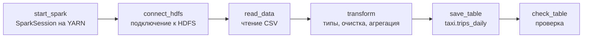

# Домашнее задание №5 — обработка данных в Spark на YARN в виде потока Prefect

Цель работы — оформить обработку данных в Apache Spark как **поток (flow) Prefect**, каждый шаг которого — отдельная **задача (task)**: запуск сессии Spark под управлением YARN из [ДЗ №2](../homework2/README.md), подключение к HDFS из [ДЗ №1](../homework1/README.md), чтение данных, их трансформация и сохранение в виде таблицы в Hive Metastore из [ДЗ №3](../homework3/README.md). Spark установлен и настроен в [ДЗ №4](../homework4/README.md).

Поток обрабатывает журнал поездок такси: очищает данные, приводит типы и считает дневную статистику по районам города — число поездок, выручку, среднее расстояние, среднюю цену километра, среднюю оценку и долю оплат картой. Результат сохраняется в таблицу `taxi.trips_daily`.

Всё выполняется одной командой `./deploy.sh`, запуск можно безопасно повторять.

## Почему Prefect

Задание разрешает поток Prefect или ОАГ (DAG) Airflow. Выбран **Prefect**:

- поток — это обычный Python-скрипт с декораторами `@flow` и `@task`, он запускается командой `python flow.py`;
- для запуска не нужны постоянно работающие сервисы: Prefect сам поднимает временный локальный сервер на время выполнения потока. Airflow требует отдельные планировщик, веб-сервер и базу данных, а на edge-ноде с 4 ГБ памяти уже работают Hive Metastore, HiveServer2 и PostgreSQL;
- Prefect логирует каждую задачу отдельно: видно, какой шаг сколько выполнялся и где произошла ошибка.

## Шаги задания и задачи потока

| № | Шаг задания | Задача Prefect в `flow.py` | Что делает |
|---|---|---|---|
| 1 | Запустить сессию Spark под управлением YARN | `start_spark` | Создаёт `SparkSession` с `master("yarn")` и поддержкой Hive, печатает мастер и идентификатор приложения YARN |
| 2 | Подключиться к кластеру HDFS | `connect_hdfs` | Через API Hadoop `FileSystem` подключается к `hdfs://team-24-nn:9000` и проверяет, что входной файл существует |
| 3 | Прочитать данные, загруженные в HDFS | `read_data` | Читает CSV из HDFS в DataFrame (данные заранее загружает `scripts/02_upload.sh`) |
| 4 | Выполнить несколько трансформаций | `transform` | Приводит типы, очищает и нормализует данные, добавляет вычисляемые колонки, агрегирует по дням и районам |
| 5 | Сохранить данные как таблицу | `save_table` | Сохраняет результат в таблицу `taxi.trips_daily` (Parquet) в Hive Metastore |
| — | Проверка результата | `check_table` | Читает сохранённую таблицу обратно и выводит её |

Задачи выполняются строго по порядку: каждая следующая получает результат предыдущей (сессию Spark или DataFrame). Если какая-то задача падает, поток останавливается, а сессия Spark в любом случае закрывается (`try ... finally`).



## Архитектура

| Хост | Что работает в ДЗ №5 |
|---|---|
| `team-24-en` (edge) | **Prefect** (поток и временный сервер Prefect) и **драйвер Spark**; Hive Metastore из ДЗ №3 |
| `team-24-nn` | ResourceManager, NameNode, контейнеры YARN с ApplicationMaster и исполнителями Spark |
| `team-24-00`, `team-24-01` | DataNode, контейнеры YARN с исполнителями Spark |

Поток Prefect запускается на edge-ноде. Задача `start_spark` создаёт сессию Spark — драйвер работает здесь же, внутри процесса Python, а ResourceManager выделяет контейнеры YARN на узлах кластера под ApplicationMaster и два исполнителя. Исполнители читают данные из HDFS и выполняют трансформации, а таблица регистрируется в Hive Metastore.

Spark не устанавливается заново: используется установка `/opt/spark` из ДЗ №4 вместе с её настройками (`spark-defaults.conf`, `hive-site.xml`). Python-библиотека PySpark берётся из самой установки Spark (`$SPARK_HOME/python`), поэтому её версия гарантированно совпадает с версией Spark на кластере.

## Данные

`data/trips.csv` — журнал поездок такси за пять дней, 564 строки. Данные синтетические: файл сгенерирован специально для этого задания, а часть строк намеренно испорчена, чтобы показать очистку и приведение типов.

```
trip_id,pickup_time,district,distance_km,fare,payment_type,rating
1,2026-11-03 21:30:34,North,18.7,941.03,card,
2,2026-11-03 01:14:32,East,10.7,580.40, Card,3
...
```

Что в данных «не так»:

- названия районов и способов оплаты записаны в разном регистре и с лишними пробелами (`north`, ` CENTER `, `CASH`, ` Card`);
- у части поездок расстояние записано с запятой (`"3,5"`), как принято в русской локали;
- в нескольких строках стоимость пустая или `n/a`, а расстояние равно нулю;
- у части поездок нет оценки (`rating`).

При чтении CSV все колонки имеют тип `string`.

Скрипт `scripts/02_upload.sh` заранее загружает файл в HDFS, в `/user/prefect/input/trips.csv`, а поток уже читает его оттуда.

## Трансформации

1. **Приведение типов:** `pickup_time` → `timestamp`, `distance_km` → `double` (запятая предварительно заменяется на точку через `regexp_replace`), `fare` → `double`, `rating` → `int`.
2. **Нормализация:** районы приводятся к виду `North`, `Center` (`trim` + `initcap`), способы оплаты — к нижнему регистру (`card`, `cash`).
3. **Очистка:** отбрасываются поездки без времени, без стоимости или с нулевым расстоянием — 17 строк из 564, остаётся 547.
4. **Вычисляемые колонки:** дата поездки `trip_date` и цена километра `price_per_km = fare / distance_km`.
5. **Агрегация** по дате и району: число поездок, суммарная выручка, среднее расстояние, средняя цена километра, средняя оценка (поездки без оценки при расчёте среднего не учитываются) и доля оплат картой в процентах.

### Итоговая таблица `taxi.trips_daily`

| Колонка | Тип | Описание |
|---|---|---|
| `trip_date` | string | дата |
| `district` | string | район города |
| `trips` | bigint | число поездок |
| `total_fare` | double | суммарная выручка |
| `avg_distance_km` | double | среднее расстояние, км |
| `avg_price_per_km` | double | средняя цена километра |
| `avg_rating` | double | средняя оценка |
| `card_share_pct` | double | доля оплат картой, % |

В таблице 25 строк — по одной на каждый из 5 районов за каждый из 5 дней. Она сохраняется в формате Parquet в каталог `/user/hive/warehouse/taxi.db/trips_daily` и регистрируется в Hive Metastore, поэтому её видят и Spark, и Hive. Режим `overwrite` пересоздаёт таблицу при каждом запуске, поэтому повторный запуск не создаёт дубликатов.

## Структура

```
homework5/
├── README.md               # эта инструкция
├── config.env              # пути к Spark, Hadoop и Java
├── requirements.txt        # зависимости Python (Prefect)
├── deploy.sh               # всё задание одной командой
├── flow.py                 # поток Prefect: задачи обработки данных в Spark
├── data/
│   └── trips.csv           # исходные данные — журнал поездок такси
└── scripts/
    ├── 01_setup.sh         # виртуальное окружение Python и установка Prefect
    ├── 02_upload.sh        # загрузка исходных данных в HDFS
    └── 03_run_flow.sh      # запуск потока Prefect
```

При запуске создаётся каталог `.venv/` с виртуальным окружением Python (в git не попадает).

## Как запустить

### Что нужно заранее

- Работающие HDFS (ДЗ №1), YARN (ДЗ №2) и Hive Metastore (ДЗ №3).
- Установленный и настроенный Spark из ДЗ №4 (`/opt/spark`).
- Доступ к edge-ноде `team-24-en` по SSH, `sudo` без пароля и доступ в интернет для установки Prefect через `pip`.

### 1. Подключиться к edge-ноде и обновить репозиторий

```bash
ssh team@2.59.83.107
cd PlatformsOfData
git pull
cd homework5
```

### 2. Запустить

```bash
./deploy.sh
```

Скрипт по порядку выполняет три шага из папки `scripts/`. Первый запуск занимает несколько минут — в основном на установку Prefect. Сам поток выполняется 1–2 минуты.

Так как соединение с сервером иногда обрывается, запуск удобно выполнять внутри `tmux`:

```bash
tmux new -s hw5
./deploy.sh
# после переподключения: tmux attach -t hw5
```

### 3. Проверить результат

Prefect выводит журнал потока `hw5-spark-yarn-flow`: начало и завершение каждой задачи и всё, что она напечатала. Должно быть:

- `master: yarn` и идентификатор приложения YARN (`start_spark`);
- `подключено к HDFS: hdfs://team-24-nn:9000` и размер входного файла (`connect_hdfs`);
- `прочитано строк: 564` и схема, где все колонки — `string` (`read_data`);
- `строк после очистки: 547` и схема с приведёнными типами (`transform`);
- `таблица сохранена: taxi.trips_daily` (`save_table`);
- `строк в таблице: 25` и сама таблица (`check_table`);
- в конце — `Finished in state Completed()`: поток завершился успешно.

Приложение `hw5-prefect-trips` также видно в веб-интерфейсе ResourceManager (http://localhost:8088 через SSH-туннель из ДЗ №2) со статусом **SUCCEEDED**.

### 4. Веб-интерфейс Prefect (по желанию)

По умолчанию Prefect поднимает временный сервер только на время запуска потока, и история запусков не сохраняется. Чтобы посмотреть поток в веб-интерфейсе Prefect, на edge-ноде запустите постоянный сервер в отдельном окне `tmux`:

```bash
cd ~/PlatformsOfData/homework5
.venv/bin/prefect server start --host 0.0.0.0
```

В другом окне укажите потоку этот сервер и запустите его:

```bash
export PREFECT_API_URL=http://127.0.0.1:4200/api
bash scripts/03_run_flow.sh
```

На своём компьютере поднимите туннель и откройте http://localhost:4200:

```bash
ssh -N -L 4200:localhost:4200 team@2.59.83.107
```

В разделе **Runs** будет запуск потока `hw5-spark-yarn-flow` с шестью задачами и их журналами. Сервер Prefect занимает несколько сотен мегабайт памяти, поэтому после проверки его лучше остановить (`Ctrl + C`).

## Описание файлов

### `config.env`

Пути к Spark, Hadoop и Java. Также задаёт `HADOOP_CONF_DIR` и `YARN_CONF_DIR` (из них Spark узнаёт адреса NameNode и ResourceManager) и `HADOOP_USER_NAME=hadoop` — как и в ДЗ №4, данные в HDFS читаются и пишутся от имени владельца хранилища Hive.

### `requirements.txt`

Единственная зависимость — Prefect 3. PySpark отдельно не устанавливается: он берётся из установки Spark.

### `flow.py`

Поток Prefect `hw5-spark-yarn-flow` из шести задач, описанных выше. Все задачи помечены `cache_policy=NO_CACHE`: по умолчанию Prefect пытается кэшировать результаты задач по их входным данным, а сессию Spark и DataFrame нельзя сохранить в кэш, к тому же поток должен честно выполнять все шаги при каждом запуске. Параметр `log_prints=True` у потока отправляет всё, что печатают задачи, в журнал Prefect.

### `scripts/01_setup.sh`

Проверяет, что Spark из ДЗ №4 установлен, ставит `python3-venv`, создаёт виртуальное окружение Python в `.venv/` и устанавливает в него Prefect из `requirements.txt`.

### `scripts/02_upload.sh`

Загружает `data/trips.csv` в HDFS, в `/user/prefect/input/` (с перезаписью при повторном запуске). Это и есть «предварительная загрузка» данных на HDFS из шага 3 задания.

### `scripts/03_run_flow.sh`

Подключает PySpark из установки Spark (`$SPARK_HOME/python` и библиотеку `py4j`) и запускает `flow.py` интерпретатором из виртуального окружения.

## Возможные проблемы

| Симптом | Причина и решение |
|---|---|
| `Spark не найден в /opt/spark` | Сначала выполните ДЗ №4 (`homework4/deploy.sh`) |
| Задача `connect_hdfs` падает с `FileNotFoundError` | Входные данные не загружены: выполните `scripts/02_upload.sh` |
| `ModuleNotFoundError: No module named 'pyspark'` | Поток запущен напрямую, а не через `scripts/03_run_flow.sh`, который настраивает `PYTHONPATH` |
| Поток долго висит на `start_spark` | YARN не хватает ресурсов (например, ещё выполняется другая задача). Проверьте приложения на http://localhost:8088 |

## Проверка работы

<!-- сюда вставить скриншоты: журнал потока Prefect (все задачи и Finished in state Completed()),
     приложение hw5-prefect-trips в ResourceManager,
     (по желанию) поток в веб-интерфейсе Prefect -->
